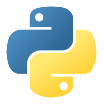

  

<h1 align="center">Hi, I'm Maximilian Förster! 👋</h1>

  <em>Developer · Model Rocketry Enthusiast · PCB Designer</em>

## 🙋‍♂️ About Me

- 📍 Based in Bavaria, Germany
- 🎂 13 years old
- 💻 I enjoy programming and building things
- 🚀 Interested in model rocketry and electronics

## 🛠️ Tech Stack

### Frontend

  
  &nbsp;&nbsp;
  
  &nbsp;&nbsp;
  

### Backend

  

### Dev Tools

  

## 🎯 Hobbies

- 🏊 Swimming
- 💻 Programming
- 🚀 Model rocketry
- 🔌 PCB design

---

  <em>Always learning, experimenting, and building something new!</em>

